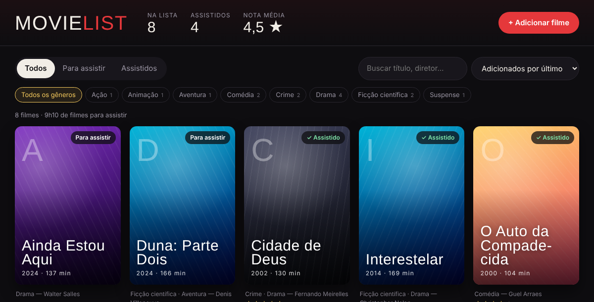

# MovieList — Filmes para assistir

Lista de filmes para assistir, com opção de marcar como assistido, dar nota, comentar e filtrar por gênero.

🔗 **[Ver o site no ar](https://iamviniciuslima05.github.io/PROJETO-MovieList/)**



## Funcionalidades

- Adicionar filmes com ano, duração, direção e **gêneros**
- Marcar como **assistido**
- **Nota de 1 a 5 estrelas** e **comentário**
- Filtro por **gênero** e por status
- Busca por título ou diretor
- Ordenar por data, nota, ano ou título
- **Cartazes gerados** automaticamente pelo título e gênero
- Contadores: total, assistidos e nota média

## Tecnologias

HTML5 · CSS3 · JavaScript · localStorage

## Estrutura

```
index.html
css/style.css
js/script.js
```

## Como rodar

Não precisa instalar nada: baixe o projeto e abra o `index.html` no navegador, ou acesse a versão publicada acima.

---
Feito por **Vinicius Lima** · [Portfólio](https://viniciuslimadev.netlify.app) · [LinkedIn](https://www.linkedin.com/in/viniciuslima25/)
